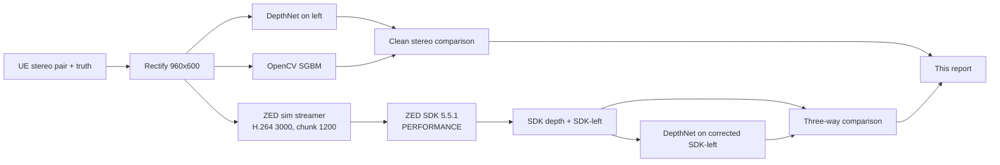

# FSAI 3070 Stereo Depth — Combined Validation Report

**Date:** 2026-10-28  
**Hardware:** NVIDIA RTX 3070 Laptop 8 GB · driver **621.01** · Windows 11  
**SDK:** ZED SDK **5.5.1** · `pyzed` **5.5.1** · official sim runtime **5.5.1** (5.2.0-labelled archive)  
**Verdict:** **PASS — pipeline, geometry and fixed command entry points; ZED SDK capture valid in PERFORMANCE mode.**

This is the single consolidated report. It replaces the former
`RUN_SUMMARY.md`, `AI_HANDOFF_NOTES.md`, `STEREO_DEPTH_VALIDATION.md` and
`ZED_SDK_SIMULATION_RESULT.md`. The same content is in
`FSAI_STEREO_RESULTS.ipynb`.

The two graph/result groups below are **not duplicates**:

- **Clean stereo benchmark:** rectified UE pair, OpenCV SGBM and DepthNet.
- **ZED SDK three-way:** the SDK's own depth from the H.264 simulation stream,
  compared with DepthNet on the same SDK-received image.

They are different inputs and different measurements, so they are kept in one
document with separate labels.

---

## 1. Executive summary

| Check | Result |
|---|---|
| Kit manifest | 461/461 |
| Unit tests | 4/4 |
| CPU replay | 419,524 px · MAE **2.613193 m** · RMSE 2.747712 m |
| Fresh mono GPU | 419,524 px · MAE **2.610419 m** · RMSE 2.745033 m |
| Clean stereo DepthNet | 100% coverage · MAE **2.530 m** · RMSE 2.718 m |
| Clean stereo SGBM | 73.00% coverage · MAE **0.791 m** · RMSE 4.301 m |
| ZED SDK PERFORMANCE | 251,213 px · 92.74% coverage · MAE **2.800 m** · RMSE 6.879 m |
| DepthNet on corrected SDK image | 100% coverage · MAE **2.211 m** · RMSE 2.464 m |
| Common SDK/DepthNet pixels | 251,213 |

The clean stereo geometry is correct: epipolar median |dy| **0.117 px**;
SGBM median |Δd| **0.265 px**, 89.5% within 1 px. On clean stereo pixels SGBM
has the lowest MAE but only 73% coverage; DepthNet is dense. On the SDK's
H.264 stream DepthNet (2.211 m) beats the SDK (2.800 m) on MAE/RMSE, while the
SDK has the lower median (1.631 m vs 2.122 m) but a heavier tail.

---

## 2. Environment and setup

| Item | Value |
|---|---|
| OS | Windows 11 (platform string `Windows-10-10.0.26300-SP0`) |
| GPU | NVIDIA GeForce RTX 3070 Laptop GPU, 8 GB |
| Driver | **621.01** (NVENC H.264/H.265 verified) |
| Python | 3.11.17 (uv-managed) |
| PyTorch | 2.11.0+cu128 |
| OpenCV | 4.12.0 |
| NumPy | 2.2.6 |
| Ultralytics | 8.4.189 (bundled `vendor/`) |
| ZED SDK | 5.5.1 (extracted package) |
| `pyzed` | 5.5.1 |
| Sim runtime | `zed_runtime/sl_zed64.dll` 5.5.1 (5.2.0-labelled) |

The venv is created at `C:\FSAI_3070_venv` and junctioned as `.venv`. The fixed
`00_setup_windows.cmd` uses uv when `py -3.11` is unavailable. The fixed
`03_install_zed_python.cmd` re-pins numpy to 2.2.6 after the SDK helper pulls
2.4.6, avoiding the OpenCV dependency conflict.

---

## 3. Data and geometry

Input is `data/stereo_demo/`: synchronized UE left/right RGB at 1280×720 from
the original ZED SN2448592 factory calibration, plus left-eye UE optical-Z truth.

| Item | Value |
|---|---|
| Rectified size | 960 × 600 |
| f (fx = fy) | 636.250 px |
| Principal point | (480.0, 300.0) px |
| Baseline B | 119.7245 mm |
| f × B | 76.1747 m·px |
| Both-eye image coverage | 100% |
| Profile | virtual ZED X One GS narrow, parallel stereo |
| Truth | UE optical Z in metres, rotated + nearest-neighbour resampled |


*Figure 1 — Rectified pair. The same rows are drawn on both eyes.*

---

## 4. Process




*Figure 2 — The fixed SDK path: driver 621.01, extended struct, chunk 1200,
H.264 fallback, transport BOTH, first-frame `ENCODING_FAILED` tolerated,
PERFORMANCE mode.*

---

## 5. Clean stereo results (0 < Z ≤ 20 m, common pixels)

| Method | Valid px | Coverage | MAE | RMSE | Bias | Median | P90 |
|---|---:|---:|---:|---:|---:|---:|---:|
| DepthNet | 270,876 | 100.00% | **2.530 m** | 2.718 m | +1.970 m | 2.484 m | 2.998 m |
| OpenCV SGBM | 197,731 | 73.00% | **0.791 m** | 4.301 m | +0.453 m | 0.013 m | 0.549 m |


*Figure 3 — Clean pair: UE truth, DepthNet, SGBM and absolute errors. Depth scale
0–20 m; error scale 0–5 m.*


*Figure 4 — Clean-pair accuracy as a function of true depth. SGBM is near-perfect
at 0–4 m; DepthNet is better through most of 4–16 m; SGBM wins 16–20 m.*


*Figure 5 — Truth-implied disparity f·B/Z, SGBM disparity, and difference. This
validates the calibration and depth-from-disparity conversion.*


*Figure 6 — SIFT matches after rectification; median |dy| 0.117 px.*

---

## 6. ZED SDK three-way (PERFORMANCE mode)

The SDK capture is **PERFORMANCE**, not NEURAL, and the stream is **H.264
3000 kbps**. DepthNet is evaluated on the R/B-corrected SDK left image
(`sdk_left_corrected.png`); the raw `sdk_left.png` has a channel swap and is
invalid for DepthNet.

| Method | Valid px | Coverage | MAE | RMSE | Bias | Median | P90 | ≥3 m |
|---|---:|---:|---:|---:|---:|---:|---:|---:|
| ZED SDK | 251,213 | 92.74% | **2.800 m** | 6.879 m | +2.725 m | 1.631 m | 2.910 m | 9.7% |
| DepthNet (same image) | 270,876 | 100% | **2.211 m** | 2.464 m | +1.567 m | 2.122 m | 2.725 m | 7.1% |

Common pixels: **251,213**. DepthNet wins MAE/RMSE/coverage; the SDK has the
lower median but a heavier tail. Two PERFORMANCE captures gave MAE **2.800 m**
and **3.117 m** (coverage 92.74% and 92.33%); this report uses the **2.800 m**
fixed-04 run. The variation is H.264/IDR/duplicate-frame timing, not a
deterministic benchmark.


*Figure 7 — SDK-received left (R/B-corrected), UE truth, SDK depth, DepthNet on
the same image, and both error maps.*


*Figure 8 — SDK and DepthNet vs truth on the same common pixels.*


*Figure 9 — SDK/DepthNet accuracy vs true depth on the H.264 stream.*

---

## 7. Why the stock SDK path failed, and the exact fix

The driver and calibration were not the problem. The experimental producer on
Windows was.

- **[Stereolabs issue #63](https://github.com/stereolabs/zed-isaac-sim/issues/63)**
  documents that the bundled `sl_zed64.dll` needs extra `StreamingParameters`
  fields after `chunk_size` (`adaptative_bitrate`, `enable_downscale`,
  `target_width`, `target_height`, `target_bitrate`), `chunk_size ≤ 1200`, an
  H.264 fallback, and an explicit GPU context.
- **[Stereolabs issue #61](https://github.com/stereolabs/zed-isaac-sim/issues/61)**
  says the first frame of a network stereo stream can log `ENCODING_FAILED`; 5.3
  changed that. It is not fatal.
- The official [`build.bat`](https://github.com/stereolabs/zed-isaac-sim/blob/f9160973f321ec743f626188244cd9702d85bec6/build.bat)
  pins `SL_ZED_VERSION=5.2.0`. The CDN has no 5.5.1 runtime (403); the 5.2.0
  archive reports 5.5.1 but sends **1,216-byte** metadata while the 5.5.1
  consumer expects **2,904**:
  `Incorrect metadata size. Expecting: 2904 got 1216. Skipping.`
  The consumer skips camera settings, but K/baseline pass.

The fixed producer/consumer settings are: `chunk_size=1200`; extended struct
with `target_width/height/bitrate`; H.264, 3000 kbps; transport BOTH;
stream-relative timestamps; first `ENCODING_FAILED` tolerated for 10 frames;
depth mode **PERFORMANCE**. The canonical fixed files are
`scripts/run_sdk_fixed.py` and `scripts/sim_streamer_fixed.py`.

NEURAL is still unavailable because the extracted SDK's TensorRT DLLs are not
on the consumer search path (`NEURAL TRT NOT FOUND`). Do not call PERFORMANCE
NEURAL.

---

## 8. Command/test matrix (fixed entry points)

| Entry point | Result | Notes |
|---|---|---|
| `00_setup_windows.cmd` | **PASS** | uv fallback; venv + junction; CUDA PyTorch/requirements |
| `01_verify_and_replay.cmd` | **PASS** | 461/461; replay MAE 2.613193 m / RMSE 2.747712 m |
| `02_run_depthnet.cmd` | **PASS** | mono GPU MAE 2.610419 m / RMSE 2.745033 m |
| `03_install_zed_python.cmd` | **PASS** | pyzed 5.5.1; numpy re-pinned 2.2.6 |
| `03b_download_sim_runtime_IF_NEEDED.cmd` | **Expected refusal** | runtime DLL already present |
| `04_run_zed_three_way_EXPERIMENTAL.cmd` | **PASS** | fixed producer/consumer; PERFORMANCE; corrected compare; update the combined report if metrics change |
| `05_collect_results.cmd` | **PASS** | `FSAI_results_20261028T220417Z.zip` (33.4 MB) |
| Unit tests | **PASS** | 4/4 |
| `verify_manifest.py` | **PASS** | 461/461; fixed `00`/`03`/`04` hashes updated |

The original stock `00`/`03`/`04` files are preserved in
`analysis/original_cmd/`. The fixed versions are the current entry points.

---

## 9. AI handoff — do not repeat these diagnoses

1. **Driver/NVENC is solved.** 555.97 → 621.01; NVENC H.264/H.265 works. The
   install initially failed with `Error 112` (disk space), not a bad package.
2. **No 5.5.1 runtime on the CDN.** `build.bat` pins 5.2.0; 5.5.1 paths 403.
   Metadata 1216 vs 2904 is expected; K/baseline pass.
3. **Stock original `04` fails; current fixed `04` passes.** Do not restore the
   stock producer. The fix is in `scripts/run_sdk_fixed.py` and
   `scripts/sim_streamer_fixed.py`.
4. **The fix:** chunk 1200, extended target fields, H.264/3000, transport BOTH,
   tolerate the first `ENCODING_FAILED`, PERFORMANCE.
5. **NEURAL is not available yet.** Copy the SDK TensorRT DLLs into
   `site-packages/pyzed` before retrying NEURAL; do not label PERFORMANCE as
   NEURAL.
6. **`sdk_left.png` has an R/B swap.** Use `sdk_left_corrected.png` for DepthNet;
   the 9.34 m DepthNet result on the swapped file is invalid.
7. **Run variation:** SDK MAE 2.800/3.117 m across two captures; this report
   uses 2.800 m.
8. **Cleanup:** dependencies were removed after the final commit. The fixed
   `00` rebuilds the venv; `03` needs the SDK/runtime restored; `04` then runs.
9. **Do not commit** `.venv`, SDK trees, runtime DLLs, wheels, `.npy` arrays,
   bridge temp dirs or result zips; `.gitignore` excludes them.
10. **Do not report** the invalid 9.34 m DepthNet or the 0-valid-pixel capture as
    the result.

### Expected values

| Check | Expected |
|---|---|
| Manifest | 461/461 |
| Unit tests | 4/4 |
| Replay | 419,524 px; 2.613193 m / 2.747712 m |
| Mono GPU | 419,524 px; 2.610419 m / 2.745033 m |
| Clean DepthNet | 2.530 m / 2.718 m / 100% |
| Clean SGBM | 0.791 m / 4.301 m / 73.0% |
| SDK PERFORMANCE | 251,213 px; 92.74%; 2.800 m / 6.879 m |
| DepthNet on corrected SDK image | 270,876 px; 100%; 2.211 m / 2.464 m |

---

## 10. Cleanup and reproduction

Removed after the final commit: `C:\FSAI_3070_venv`, `.venv`,
`L:\...\ZED_SDK_extract`, `zed_runtime\sl_zed64.dll`, downloaded wheels,
installer, `C:\Users\V9\innoextract`, and the temporary Jupyter kernel.
**C: 12.97 GB free · L: 25.13 GB free.**

To reproduce from this clean state:

```powershell
# 1. Restore SDK 5.5.1 to L:\save\userdata\Downloads\ZED_SDK_extract
#    and the 5.2.0 sim runtime to zed_runtime\sl_zed64.dll.
# 2. Rebuild and run:
.\00_setup_windows.cmd
$env:ZED_SDK_ROOT_DIR = 'L:\save\userdata\Downloads\ZED_SDK_extract\app'
.\03_install_zed_python.cmd
.\03b_download_sim_runtime_IF_NEEDED.cmd   # only if runtime absent
.\04_run_zed_three_way_EXPERIMENTAL.cmd
.\05_collect_results.cmd
```

The 5.2.0 runtime archive contains a `.tar` inside the `.tar.gz`; extract twice.
The fixed `04` handles the R/B correction and the corrected comparison; update
this report if the new metrics differ.

### Artifacts

| Path | Content |
|---|---|
| `FSAI_STEREO_DEPTH_REPORT.md` | This report |
| `FSAI_STEREO_RESULTS.ipynb` | Same content as the notebook |
| `FSAI_results_20261028T220417Z.zip` | Collected outputs (33.4 MB) |
| `outputs/stereo_validation/` | Clean stereo results/figures/tables |
| `outputs/sdk_three_way/` | SDK capture, comparison, figures |
| `analysis/original_cmd/` | Original stock `00`/`03`/`04` |
| `scripts/run_sdk_fixed.py`, `scripts/sim_streamer_fixed.py` | Fixed bridge |
| `analysis/run_sdk_success_experimental.py`, `analysis/sim_streamer_success_experimental.py` | Development copies |

**Proof/references:** [Stereolabs zed-isaac-sim](https://github.com/stereolabs/zed-isaac-sim) ·
[Issue #63](https://github.com/stereolabs/zed-isaac-sim/issues/63) ·
[Issue #61](https://github.com/stereolabs/zed-isaac-sim/issues/61) ·
[`build.bat`](https://github.com/stereolabs/zed-isaac-sim/blob/f9160973f321ec743f626188244cd9702d85bec6/build.bat)
