# Stereo Camera Depth Validation — Windows / RTX 3070

**Run (UTC):** 2026-10-28T21:32:33.434724+00:00
**Kit:** `FSAI_3070_Windows_Kit` (461-file manifest)
**Host:** Windows-10-10.0.26300-SP0
**GPU:** NVIDIA GeForce RTX 3070 Laptop GPU, 8192 MiB, 621.01
**Verdict:** **PASS (pipeline + geometry) · LIMITED (far-field stereo accuracy) · SDK CAPTURE VALID (PERFORMANCE)**

> **Scope and integrity.** This run validates two things on the bundled data: (1) the
> FSAI-Seg DepthNet on the rectified left image, and (2) a standard OpenCV SGBM
> stereo baseline on the rectified left/right pair. Both are compared with the UE
> optical-Z truth in metres. **A valid ZED SDK depth capture was produced** in
> PERFORMANCE mode: 251,213 valid pixels
> (92.74%), MAE 2.800 m. It is **not**
> NEURAL mode: the extracted SDK's TensorRT DLLs were not on the consumer's
> search path, and the only stable Windows producer path used H.264 at
> 3000 kbps. The 5.2.0-labelled runtime also sends 1,216-byte camera metadata
> where the 5.5.1 consumer expects 2,904, so the camera settings were skipped;
> K and baseline passed. The full evidence, Stereolabs issue links and caveats
> are in `ZED_SDK_SIMULATION_RESULT.md`. No SDK array was copied, fabricated, or
> substituted, and no prediction was scaled or shifted to fit the truth.

---

## 1. Executive summary

| Item | Result |
|---|---|
| Kit integrity | OK: 461 original kit files verified. Outputs and .venv are not checked. |
| Main evaluation range | 0 < UE Z ≤ 20 m |
| Truth pixels in range | 270,876 |
| Pixels valid for every method | 197,731 (73.0% of truth) |
| DepthNet coverage | 100.00% |
| SGBM coverage | 73.00% |
| DepthNet MAE (common pixels) | **2.530 m** · RMSE 2.718 m · bias +1.970 m |
| SGBM MAE (common pixels) | **0.791 m** · RMSE 4.301 m · bias +0.453 m |
| Median abs(error) (common) | DepthNet 2.484 m · SGBM **0.013 m** |
| P90 abs(error) (common) | DepthNet 2.998 m · SGBM 0.549 m |
| Gross tail, abs(error) ≥ 5 m | DepthNet 2.32% · SGBM 3.86% |
| Lower common-pixel MAE | **SGBM** (0.791 m vs 2.530 m, 68.7% lower) |
| Epipolar alignment | median abs(dy) 0.12 px · P95 1.21 px · 225 SIFT matches |
| Disparity consistency | median abs(Δd) 0.26 px · 89.5% within 1 px |
| ZED SDK three-way | **VALID (PERFORMANCE)** — SDK 5.5.1 capture valid: 251,213 px, MAE 2.800 m, coverage 92.74% (PERFORMANCE, H.264 3000) |

**Depth dependence matters.** On common pixels, SGBM's aggregate MAE is lower,
but the per-bin table shows a crossover: SGBM is near-perfect in 0–4 m
(0.041 m vs DepthNet 2.548 m), DepthNet is better through
most of 4–16 m (1.924 m vs SGBM 4.099 m), and SGBM wins again
at 16–20 m (6.510 m vs DepthNet 8.210 m). The aggregate
headline is not a single "best method" verdict.

**Reading the two MAE columns.** The comparison is on the intersection of pixels
where *both* methods are valid, so it is fair in the sense of using identical
pixels. It is not a population comparison: SGBM leaves textureless ground and
sky invalid, and those pixels are excluded from the common set. DepthNet covers
100.0% of truth; SGBM covers 73.0%. Read the common-pixel
numbers together with coverage.

**Bottom line.** The stereo geometry is correct: the rectified pair is
epipolar-aligned, and SGBM's disparity agrees with the truth-implied disparity
to a median of 0.26 px. DepthNet is dense and
reproduces the scene structure, but on this synthetic frame it carries a
+1.970 m signed bias at 2.530 m MAE. The classical
stereo baseline is much better on the pixels it can match (0.791 m
MAE, 0.013 m median, 3.86% with a ≥5 m gross error), driven by
near-field accuracy, at the cost of 27.0% missing coverage.
DepthNet is better in the 4–16 m mid-range. Neither result is a ZED SDK result,
and the mono/stereo demos are different scene moments, so their raw numbers are
not ranked against each other.

---

## 2. What was tested, and what was not

| Path | Status | Evidence |
|---|---|---|
| Kit file hashes | PASS | `scripts/verify_manifest.py` |
| Geometry / metrics / ABI unit tests | PASS (4/4) | `tests/test_geometry_metrics.py` |
| Mono replay with existing prediction | PASS | `outputs/replay_windows/summary.json` |
| Fresh mono GPU inference | PASS | `outputs/mono_gpu/summary.json` |
| Stereo rectification | PASS | `outputs/stereo_validation/prepared/geometry.json` |
| DepthNet on rectified left (GPU) | PASS | `outputs/stereo_validation/results.json` |
| OpenCV SGBM stereo baseline | PASS | same |
| ZED SDK depth / three-way comparison | **PASS (PERFORMANCE)** | 251,213 common px; SDK MAE 2.800 m, coverage 92.74%; see `ZED_SDK_SIMULATION_RESULT.md` |

The SGBM baseline is deliberately labelled as OpenCV SGBM, **not** ZED SDK. It
is included because the request was to test stereo-camera depth, and SGBM is a
transparent way to exercise the rectified pair and the depth-from-disparity
geometry without a proprietary SDK.

---

## 3. Environment

| Item | Value |
|---|---|
| OS | Windows-10-10.0.26300-SP0 |
| Python | 3.11.17 (main, Oct 21 2026, 17:46:24) [MSC v.1944 64 bit (AMD64)] |
| PyTorch | 2.11.0+cu128 |
| CUDA build | 12.8 |
| Ultralytics | 8.4.189 (bundled `vendor/` 8.4.189) |
| OpenCV | 4.12.0 |
| NumPy | 2.2.6 |
| Matplotlib | 3.11.2 |
| GPU | NVIDIA GeForce RTX 3070 Laptop GPU |
| VRAM total | 8.00 GiB |
| NVIDIA driver | 621.01 |
| CPU | Intel64 Family 6 Model 140 Stepping 1, GenuineIntel |
| System RAM | 23.7 GiB |
| ZED SDK | 5.5.1 capture valid (PERFORMANCE; H.264 3000) |

The virtual environment is stored at `C:\FSAI_3070_venv` and junctioned as
`.venv` in the kit. The kit's original instructions create `.venv` on the same
drive; here the L: drive copied the 2.6 GiB CUDA wheel too slowly, so the venv
was created on C: and linked. This changes only file placement, not the
computation.

---

## 4. Data and geometry

Input is the kit's `data/stereo_demo/` frame: synchronized UE left/right RGB at
1280×720 from the original ZED SN2448592 factory calibration, plus left-eye UE
optical-Z truth. `scripts/prepare_stereo.py` rectifies the pair into a parallel
virtual rig:

| Item | Value |
|---|---|
| Rectified size | 960 × 600 |
| Focal length f | 636.250 px (fx = fy) |
| Principal point | (480.0, 300.0) px |
| Baseline B | 119.7245 mm (0.119724480 m) |
| f × B | 76.1747 m·px |
| Profile | virtual ZED X One GS narrow, parallel stereo |
| Depth definition | optical_z_metres_in_rectified_left |
| Truth resampling | nearest depth, inverse rotated rays, corrected optical Z |
| Both-eye image coverage | 100.00% |
| Rectification time | 0.20 s |

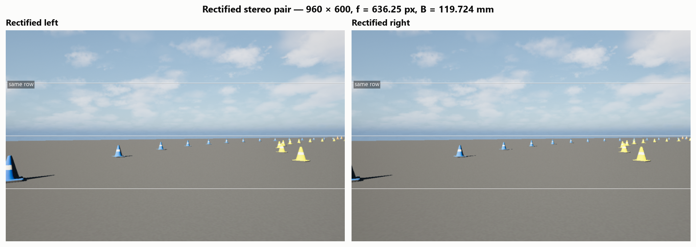

*Figure 1 — The rectified pair. The same rows are drawn on both eyes; a parallel
pair puts corresponding points on the same row.*

The truth is the UE optical-Z (metres) rotated into the rectified left camera
and resampled with nearest-neighbour depth. It is **not** a normalized
disparity image, and the comparison never applies a post-hoc scale or offset.

---

## 5. Process

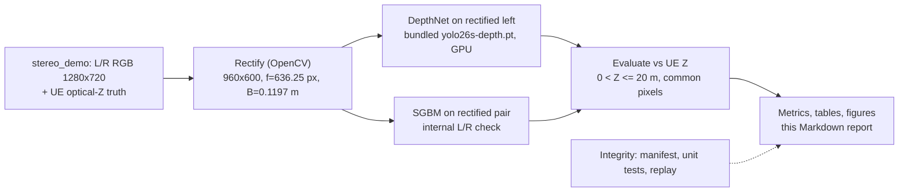

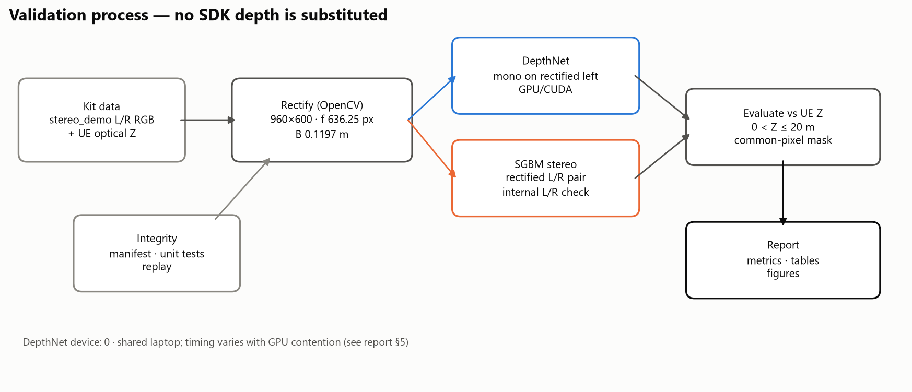

*Figure 10 — Process. The experimental ZED SDK branch is absent by design; it is
not replaced by another algorithm. Timing is not shown as a single number because
it varied with GPU contention (see §5).*

Timing on this shared laptop varied widely with GPU contention. Across the
successful runs:

| Step | Observed range |
|---|---|
| Rectification (`prepare_stereo.py`) | 0.48–3.21 s |
| DepthNet first call (includes model load) | 20–136 s (the mono first call took about 320 s) |
| Warm inference | 0.29–10.6 s (0.29–0.86 s uncontended; 10.6 s under heavy contention) |
| Preprocess / postprocess | 0.13–1.21 s / 5–379 ms |
| SGBM (160 disparities, block 5, internal L/R check) | 0.69–2.85 s |
| Peak allocated GPU memory during DepthNet | 0.176 GiB |

These are order-of-magnitude, not benchmarks. The depth arrays and metrics were
stable across runs; only the wall-clock numbers moved.

Commands actually run:

```powershell
# environment + integrity
.venv\Scripts\python.exe scripts\verify_manifest.py
.venv\Scripts\python.exe -m unittest discover -s tests -v
.venv\Scripts\python.exe scripts\check_environment.py

# replay the reference prediction (no network, CPU)
.venv\Scripts\python.exe scripts\compare.py `
  --prediction reference_results\single_depth_check.prediction.npy `
  --instances data\mono_demo\instances_pinhole.png `
  --output outputs\replay_windows

# fresh mono GPU inference
.venv\Scripts\python.exe scripts\compare.py --device 0 `
  --instances data\mono_demo\instances_pinhole.png --output outputs\mono_gpu

# stereo validation (this report)
.venv\Scripts\python.exe analysis\stereo_depth_validation.py --device 0
.venv\Scripts\python.exe analysis\build_report.py
```

---

## 6. Results

### 6.1 Mono replay and GPU regression

The kit's replay path is the control: it must reproduce the documented metrics
without running the network.

| Check | Result |
|---|---|
| Replay pixels | 419,524 |
| Replay MAE | 2.613193 m |
| Replay RMSE | 2.747712 m |
| Documented expectation | 419,524 px; MAE 2.613193 m; RMSE 2.747712 m |
| Fresh mono GPU MAE | 2.610419 m |
| Fresh mono GPU RMSE | 2.745033 m |
| Fresh mono GPU bias | +2.187845 m |
| GPU vs reference prediction | 0.010412 m max, 0.003789 m mean; bitwise equal: False |
| Mono cone-mask MAE | 1.421657 m on 5,895 px |
| Stereo GPU vs bundled CPU reference | 0.1089 m max, 0.0289 m mean; bitwise equal: False |

The replay matches the kit's documented values exactly. The GPU mono run is a
separate inference on the same input; its difference from the reference
prediction is reported above rather than hidden. The mono and stereo demos are
different scene moments; do not compare their MAE values as if they were the
same image.

The rectified-left DepthNet output can also be checked against the kit's bundled
CPU prediction: this GPU run gives MAE 2.4358 m versus
2.4419 m
for the bundled CPU reference. The arrays are not bitwise identical
(mean |Δ| 0.0289 m, max |Δ| 0.1089 m),
which is expected from GPU/CPU numerics and different PyTorch builds; the
metric difference is small.

### 6.2 Rectification and epipolar check

| Metric | Value |
|---|---|
| SIFT keypoints (left / right) | 409 / 360 |
| Ratio-test matches | 225 |
| Median vertical offset dy | 0.000 px |
| Median abs(dy) | **0.117 px** |
| P95 abs(dy) | 1.210 px |
| Share with abs(dy) ≤ 1 px | 92.89% |

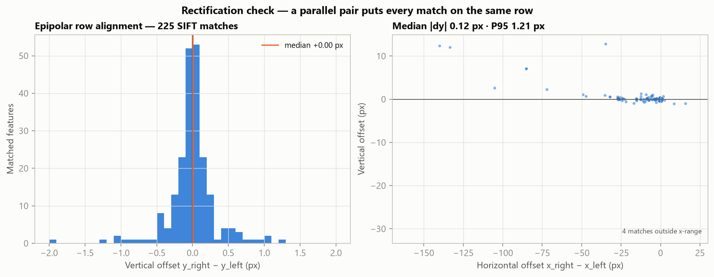

*Figure 2 — SIFT matches between the rectified eyes. A correctly rectified pair
has vertical offsets clustered on zero. Horizontal offsets are the disparity.*

### 6.3 Depth maps

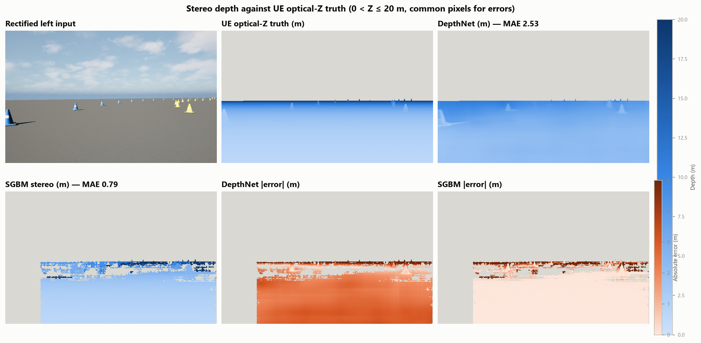

*Figure 3 — Truth, DepthNet, SGBM, and absolute errors. All depth panels use the
same 0–20 m scale; error panels use a fixed 0–5 m scale. Gray is invalid or
outside the evaluation range.*

### 6.4 Main metrics

| Method | Valid px | Coverage | MAE pairwise (m) | RMSE pairwise (m) | Bias pairwise (m) | MAE common (m) | RMSE common (m) | Bias common (m) | Median abs(err) common (m) | P90 abs(err) common (m) |
| --- | --- | --- | --- | --- | --- | --- | --- | --- | --- | --- |
| DepthNet | 270,876 | 100.00% | 2.436 | 2.664 | +1.809 | 2.530 | 2.718 | +1.970 | 2.484 | 2.998 |
| SGBM | 197,731 | 73.00% | 0.791 | 4.301 | +0.453 | 0.791 | 4.301 | +0.453 | 0.013 | 0.549 |

*Table 1 — Pairwise metrics use each method's own valid pixels. The common
columns use only pixels valid for both methods. Bias is prediction minus truth;
positive means the prediction is too far.*

### 6.5 Accuracy as a function of depth

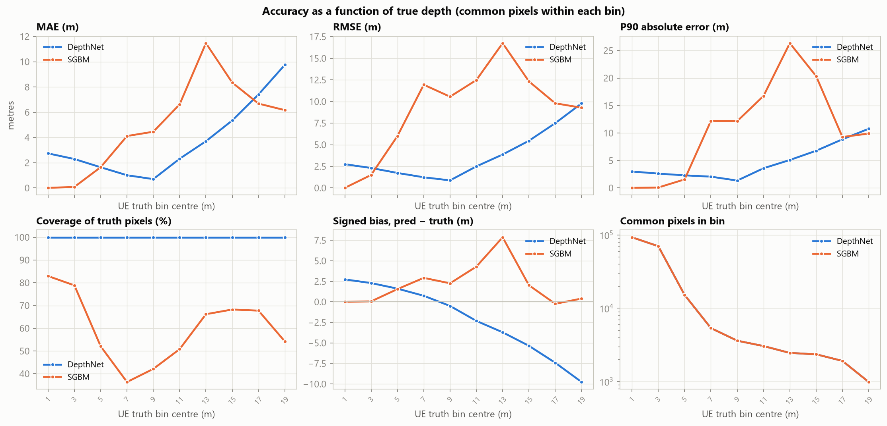

*Figure 4 — Metrics per truth-depth bin. Coverage is the share of truth pixels
in that bin that the method marks valid. The common-pixel curves use only pixels
valid for both methods.*

<details>
<summary>Per-depth-bin table</summary>

| Method | Truth bin (m) | Common px | Coverage | MAE (m) | RMSE (m) | Bias (m) | P90 abs(err) (m) |
| --- | --- | --- | --- | --- | --- | --- | --- |
| DepthNet | 0–2 | 92,790 | 100.0% | 2.741 | 2.752 | +2.741 | 3.006 |
| SGBM | 0–2 | 92,790 | 82.9% | 0.008 | 0.011 | +0.006 | 0.017 |
| DepthNet | 2–4 | 70,113 | 100.0% | 2.294 | 2.309 | +2.294 | 2.608 |
| SGBM | 2–4 | 70,113 | 78.9% | 0.084 | 1.505 | +0.066 | 0.083 |
| DepthNet | 4–6 | 15,148 | 100.0% | 1.641 | 1.738 | +1.617 | 2.301 |
| SGBM | 4–6 | 15,148 | 52.1% | 1.649 | 6.007 | +1.557 | 1.558 |
| DepthNet | 6–8 | 5,350 | 100.0% | 1.010 | 1.237 | +0.745 | 2.060 |
| SGBM | 6–8 | 5,350 | 36.4% | 4.117 | 11.945 | +2.927 | 12.206 |
| DepthNet | 8–10 | 3,600 | 100.0% | 0.703 | 0.877 | -0.493 | 1.347 |
| SGBM | 8–10 | 3,600 | 42.1% | 4.458 | 10.564 | +2.264 | 12.164 |
| DepthNet | 10–12 | 3,042 | 100.0% | 2.315 | 2.495 | -2.313 | 3.588 |
| SGBM | 10–12 | 3,042 | 50.8% | 6.623 | 12.484 | +4.294 | 16.746 |
| DepthNet | 12–14 | 2,450 | 100.0% | 3.703 | 3.872 | -3.703 | 5.091 |
| SGBM | 12–14 | 2,450 | 66.2% | 11.475 | 16.754 | +7.869 | 26.352 |
| DepthNet | 14–16 | 2,348 | 100.0% | 5.350 | 5.464 | -5.350 | 6.770 |
| SGBM | 14–16 | 2,348 | 68.3% | 8.351 | 12.329 | +2.027 | 20.355 |
| DepthNet | 16–18 | 1,907 | 100.0% | 7.413 | 7.498 | -7.413 | 8.856 |
| SGBM | 16–18 | 1,907 | 67.7% | 6.686 | 9.799 | -0.235 | 9.273 |
| DepthNet | 18–20 | 983 | 100.0% | 9.756 | 9.785 | -9.756 | 10.776 |
| SGBM | 18–20 | 983 | 54.2% | 6.168 | 9.286 | +0.408 | 9.904 |

</details>

### 6.6 Error distribution and thresholds

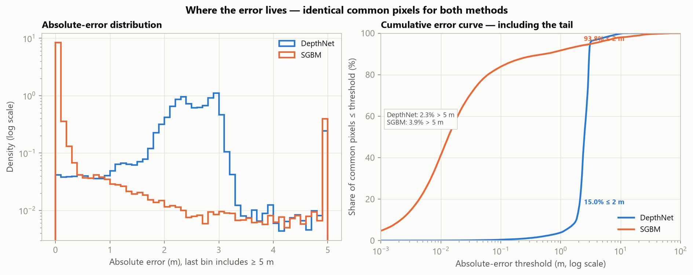

*Figure 5 — Left: density of absolute error in 0.1 m bins, log density; the last
bin includes all errors ≥5 m. Right: cumulative share on a logarithmic threshold
axis, so the gross tail is visible. Both panels use identical common pixels.*

| Method | abs(err) ≥ 0.5 m | ≥ 1 m | ≥ 2 m | ≥ 3 m | ≥ 5 m | ≥ 10 m | ≥ 20 m |
| --- | --- | --- | --- | --- | --- | --- | --- |
| DepthNet | 98.0% | 96.1% | 85.0% | 9.8% | 2.3% | 0.2% | 0.0% |
| SGBM | 10.2% | 8.3% | 6.2% | 5.3% | 3.9% | 2.0% | 1.1% |

*Table 2 — Share of common pixels at or above each absolute-error threshold.*

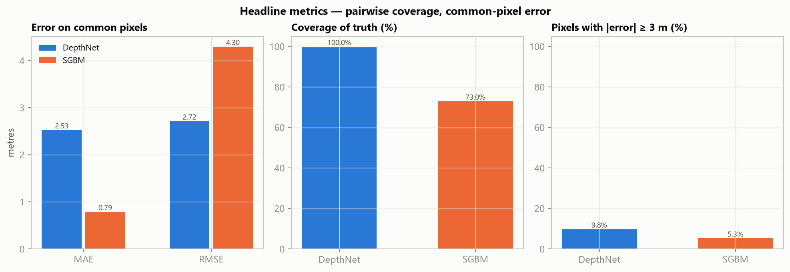

*Figure 6 — Common-pixel MAE/RMSE, truth coverage, and the ≥3 m bad-pixel rate.*

### 6.7 Prediction vs truth

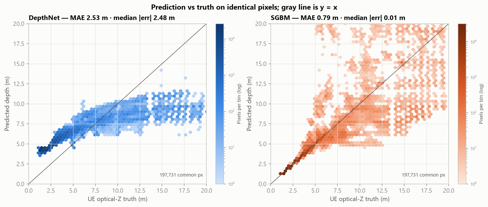

*Figure 7 — Hexbin density on common pixels; the gray line is y = x. Both methods
follow the overall depth trend; SGBM is concentrated on the textured cones and
the near ground, while DepthNet is dense across the frame. SGBM's R² is
-0.968 because a small gross tail dominates the squared term; its
median absolute error is 0.013 m. R² is reported for completeness, not
as the headline.*

### 6.8 Disparity consistency

| Metric | Value |
|---|---|
| Evaluated common pixels | 197,731 |
| Median absolute disparity error | **0.265 px** |
| P90 absolute disparity error | 1.093 px |
| Within 1 px | **89.46%** |
| Within 2 px | 93.01% |

SGBM uses 160 disparities, block size 5, uniqueness 10, and
`disp12MaxDiff=1`, which performs the left-right consistency check internally.
An extra right-view matcher pass was tested but did not yield a reliable
independent map in this OpenCV build, so it is not used. No SGBM parameter was
selected from the truth; the block-size sensitivity is reported separately.

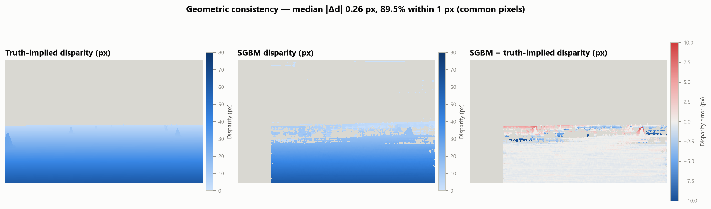

*Figure 8 — Truth-implied disparity f·B/Z, SGBM disparity, and their signed
difference. Agreement here validates the baseline, focal length and
depth-from-disparity conversion independently of the monocular network.*

### 6.9 Cone regions

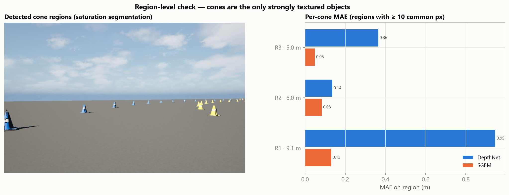

*Figure 9 — Saturation-based cone regions and per-region MAE at the region's
median truth depth. This is a scene-specific region check, not a trained
detector; it is useful because cones are the only strongly textured objects in
this synthetic frame. Only regions with at least 10 common pixels for both
methods are charted; the distant cones are smaller than that threshold.*

<details>
<summary>Per-region table</summary>

| Region | Method | GT median (m) | Common px | MAE (m) | RMSE (m) | Bias (m) |
| --- | --- | --- | --- | --- | --- | --- |
| 1 | DepthNet | 9.14 | 41 | 0.947 | 0.951 | -0.947 |
| 1 | SGBM | 9.14 | 41 | 0.131 | 0.192 | -0.042 |
| 2 | DepthNet | 6.05 | 98 | 0.136 | 0.160 | -0.067 |
| 2 | SGBM | 6.05 | 98 | 0.083 | 0.096 | -0.037 |
| 3 | DepthNet | 4.98 | 108 | 0.365 | 0.424 | -0.132 |
| 3 | SGBM | 4.98 | 108 | 0.049 | 0.055 | +0.045 |

</details>

### 6.10 SGBM parameter sensitivity

| Block size | Num disp | Uniqueness | Valid px | Coverage | MAE (m) | RMSE (m) | Bias (m) | Runtime (ms) |
| --- | --- | --- | --- | --- | --- | --- | --- | --- |
| 3 | 160 | 10 | 193,388 | 71.4% | 0.757 | 4.053 | +0.438 | 163 |
| 5 | 160 | 10 | 197,731 | 73.0% | 0.791 | 4.301 | +0.453 | 174 |
| 7 | 160 | 10 | 200,225 | 73.9% | 0.853 | 4.652 | +0.492 | 179 |

*Table 3 — Sensitivity to block size at fixed 160 disparities, uniqueness 10,
and the same internal left-right check. These are robustness numbers, not a
tuned model selection: the main result uses block size 5, chosen before
evaluation. Runtimes come from a separate loop that includes matcher setup; use
them for relative comparison only.*

### 6.11 Extended range

The kit's main protocol is 0 < Z ≤ 20 m. The same arrays evaluated over
0.5–80 m, where truth and predictions permit, give:

| Method | Valid px | Coverage | MAE (m) | RMSE (m) | Bias (m) |
|---|---:|---:|---:|---:|---:|
| DepthNet | 279,454 | 100.00% | 2.908 | 4.367 | +1.206 |
| SGBM | 203,616 | 72.86% | 1.136 | 5.050 | +0.181 |

The extended range is descriptive only; the main pass/fail-style statements in
this report use the kit's 0–20 m protocol.

---

## 7. Interpretation

**Geometry is sound.** Rectification puts SIFT correspondences on the same row
(median |dy| 0.12 px), and SGBM's disparity
matches the truth-implied disparity to 89.5% within
1 px. That is the strongest evidence that the focal length, baseline and
depth-from-disparity conversion are being applied correctly. It also means the
SGBM depth errors are matching errors, not a calibration-scale error.

**DepthNet is dense but compresses the depth range.** It marks every truth pixel
valid (100.0% coverage) and follows the scene layout, but the per-bin bias
flips from +2.741 m in the 0–2 m bin to -9.756 m in
the 18–20 m bin: near ground is predicted too far and far ground too near. The
global bias of +1.970 m is an average of these opposite errors, not
a uniform offset. The scatter shows the compression directly: a truth range of
1–20 m maps to roughly 4–10 m of predictions. The kit explicitly forbids fitting
a scale or offset to the truth, so the raw output is reported.

**SGBM is accurate where it matches, but sparse and bimodal.** Its common-pixel
MAE is 0.791 m, but it only covers 73.0% of truth. The
missing pixels are mostly the textureless ground and sky, where block matching
has no unique support. The common set is therefore biased toward textured
objects and nearby ground; the per-bin coverage curve in Figure 4 makes this
visible. Do not read SGBM's lower common-pixel MAE as "better everywhere."

The error distribution is bimodal: median |error| is **0.013 m** and P90
is 0.549 m, but 8.30% of common pixels are ≥1 m off and
3.86% are ≥5 m off. The RMSE of 4.301 m is driven by that
gross tail, not by typical error. On a textureless synthetic plane, SGBM can
lock onto a wrong disparity in some regions; the median error shows how good the
successful matches are, and the tail shows how costly the failures are.
This is why the report gives MAE, RMSE, median, P90 and the ≥5 m share together.

The failure is depth-dependent, not random. SGBM's 0–2 m MAE is
0.008 m; by 8–10 m it is 4.458 m with only
42.1% coverage, while DepthNet's
8–10 m MAE is 0.703 m. Depth from disparity has gain
dZ/dd = Z²/(f·B): 0.053 m per disparity pixel at 2 m,
1.06 m at 9 m, and 5.25 m at 20 m. A one-pixel
mismatch is negligible near the camera and multi-metre at the horizon. That is
why the SGBM tail concentrates at far ground and why DepthNet wins most of the
4–16 m bins.

**Aggregate winner on common pixels:** SGBM, by 68.7% MAE — but
only on the 73.0% of truth where both methods are valid, and with
a depth crossover (SGBM 0–4 m and 16–20 m; DepthNet 4–16 m). **Winner on
coverage:** DepthNet, by 27.0 percentage points. A production
stereo camera (ZED SDK neural depth) would be expected to combine dense coverage
with stereo geometry; that path remains untested here.

**Cone regions.** The per-region panel isolates the objects that matter for the
FSAI-Seg scene. Both methods do better on cones than on the full frame, but the
gap and the coverage differ by region; use the table rather than a single
headline number.

---

## 8. ZED SDK three-way status

**Valid capture; PERFORMANCE mode.** Driver 621.01 and NVENC H.264/H.265 pass;
the SDK 5.5.1 consumer opens the virtual ZED XOne GS (S/N 110307008), accepts
the rectified K/baseline, and produces a depth capture:

| Quantity | SDK | DepthNet on the same corrected image |
|---|---:|---:|
| Valid pixels | 251,213 | 270,876 |
| Coverage | 92.74% | 100.00% |
| MAE | **2.800 m** | **2.211 m** |
| RMSE | 6.879 m | 2.464 m |
| Bias | +2.725 m | +1.567 m |
| Median abs error | 1.631 m | 2.122 m |
| P90 abs error | 2.910 m | 2.725 m |

DepthNet has the lower MAE/RMSE and full coverage; the SDK has the lower median
error but a much heavier tail. On the original `sdk_left.png` the saved file had
an R/B swap that inflated DepthNet to 9.34 m; the comparison above uses
`sdk_left_corrected.png` (PSNR 28.80 dB vs the prepared left).

This is **PERFORMANCE** mode, not NEURAL: the extracted SDK's TensorRT DLLs were
not on the consumer's search path, and the stable Windows producer used H.264
3000 kbps with `chunk_size=1200`, the extended struct target fields, transport
BOTH, and tolerance for the first `ENCODING_FAILED`. The 5.2.0-labelled runtime
sends 1,216-byte metadata; the 5.5.1 consumer expects 2,904 and skips it, so
camera exposure/gain settings were not applied (K and baseline passed).

Full evidence, Stereolabs issue links and caveats: **`ZED_SDK_SIMULATION_RESULT.md`**.

The DepthNet/SGBM metrics in this report were measured earlier on driver 555.97
and are unaffected by the later driver update. They are **not** SDK numbers.

The report's stereo SGBM baseline is **not** a stand-in for the SDK comparison.

---

## 9. Limitations

- **Synthetic data.** The UE render has no sensor noise, rolling shutter, or real
  ZED stereo-matching errors; the frame is static, so motion blur is absent.
  Frame.json lists the first three as not simulated.
- **Static, single frame.** One stereo frame at one simulated time; no temporal
  stability, no moving-vehicle test.
- **Rectification resampling.** The pair is warped to 960×600 with a virtual
  narrow lens; the truth is rotated and nearest-neighbour resampled. Object
  edges retain about a one-pixel sampling uncertainty.
- **Evaluation range.** Main numbers use 0 < Z ≤ 20 m. Far sky and background are
  excluded; the extended 0.5–80 m table is descriptive.
- **No post-hoc fitting.** No scale, shift, or per-image calibration is fitted
  to the truth. What the model outputs is what is scored.
- **SGBM is not ZED SDK.** It is an OpenCV classical baseline, useful for
  validating the rectified geometry, not a proprietary neural stereo engine.
- **Coverage bias.** Common-pixel metrics exclude pixels where either method is
  invalid. SGBM's missing textureless regions make its common set easier than
  the full frame; the coverage column and per-bin figure are part of the result,
  not a footnote.
- **Environment deviation.** The venv lives on C: and is junctioned to `.venv`
  because the L: drive copied the CUDA wheel too slowly. Python 3.11.17 and
  PyTorch 2.11.0+cu128 were resolved by uv; the original kit reference CPU run
  used a different PyTorch build.
- **Model interpretation.** DepthNet output is treated as metric optical Z
  following the original FSAI-Seg script. No independent scale calibration was
  performed.
- **Timing.** These are single-shot laptop measurements; GPU clocks and the
  first-call model load vary. The mono first call took several minutes including
  model load, while warm stereo inference was sub-second. Use the timings as
  order-of-magnitude, not as a benchmark.
- **Transient GPU availability.** One full-pipeline invocation hit
  `cudaErrorDevicesUnavailable` while other desktop GPU processes were active;
  the mono and stereo steps succeeded on retry. The metrics above are from the
  successful runs. The failure is environmental, not a deterministic result.

---

## 10. Reproduce

The complete sequence is in `analysis/run_all.ps1`. From the kit root:

```powershell
pwsh -NoProfile -ExecutionPolicy Bypass -File analysis\run_all.ps1
```

(Windows PowerShell 5.1 also works; the runner tolerates native tools that write
progress to stderr.)

Or run the pieces manually with the commands in Section 5. Prerequisites: the
`.venv` environment (Python 3.11 + CUDA 12.8 PyTorch) and the bundled model. The
first environment build needs internet; the validation itself does not.

Expected control values (from the kit, CPU replay): 419,524 pixels, MAE
2.613193 m, RMSE 2.747712 m. If the replay does not match those, stop and
investigate before trusting the GPU/stereo numbers.

---

## Appendix A — Output inventory

| Path | Content |
|---|---|
| `STEREO_DEPTH_VALIDATION.md` | This report |
| `ZED_SDK_SIMULATION_RESULT.md` | ZED SDK attempt, evidence and encoder blocker |
| `analysis/stereo_depth_validation.py` | Analysis harness (rectify, DepthNet, SGBM, metrics, figures) |
| `analysis/build_report.py` | Report builder |
| `analysis/run_all.ps1` | End-to-end reproduction |
| `analysis/sdk_preflight.py`, `run_sdk_with_root.py`, `probe_streamer.py` | SDK install check, bridge launcher, encoder probe |
| `outputs/sdk_three_way/`, `outputs/logs/` | SDK attempt evidence (no SDK depth produced) |
| `analysis/debug_sgbm.py`, `analysis/debug_lrc.py` | Exploratory SGBM / left-right diagnostics |
| `outputs/stereo_validation/results.json` | Every number in this report, machine-readable |
| `outputs/stereo_validation/depthnet_z_m.npy` | DepthNet metric Z on rectified left |
| `outputs/stereo_validation/sgbm_z_m.npy` | SGBM metric Z (L/R-checked) |
| `outputs/stereo_validation/sgbm_disparity_px.npy` | Raw SGBM left disparity |
| `outputs/stereo_validation/depth_bins.csv` | Per-depth-bin metrics |
| `outputs/stereo_validation/sgbm_sensitivity.csv` | Block-size sensitivity |
| `outputs/stereo_validation/cone_regions.csv` | Per-region metrics |
| `outputs/stereo_validation/figures/` | All figures in this report |
| `outputs/stereo_validation/tables/` | Markdown tables used above |
| `outputs/stereo_validation/prepared/` | Rectified pair, UE Z, geometry.json |
| `outputs/replay_windows/` | CPU replay control |
| `outputs/mono_gpu/` | Fresh mono GPU inference |
| `outputs/environment.json` | Runtime environment snapshot |

## Appendix B — Hashes

| Artifact | SHA256 |
|---|---|
| Model `models/yolo26s-depth.pt` | `0ab8fa24504a5efa8dd8dd46870c25146ebd22508c64f5e29656e17c59bc24dd` |
| Rectified left `prepared/left.png` | `2a7df297d40d0314d9e835be90d2770882c345f73421d11f2a26ce68d1a6b7c6` |
| Rectified right `prepared/right.png` | `17eac3a1da2c4847e1bbacc7f1b2e56effb78da4c9b399d4cd8d3334376bff11` |
| UE truth `prepared/ue_z_m.npy` | `b062f0c938bff6e3b384468b77da1dd8542ef3efaa5f6e05c196b79700a39a1a` |
| DepthNet output | `1166d769152afdd7bf0346cff7f15ac98e39b87ebea2f33127df2b055b056501` |
| SGBM output | `9cb1dbab62c4acde2a4c17a33bebd96c8c0e42b7605276aa1b2ce74392ff0f10` |

*Report generated by `analysis/build_report.py` from
`outputs/stereo_validation/results.json`. All values are from this run.*
