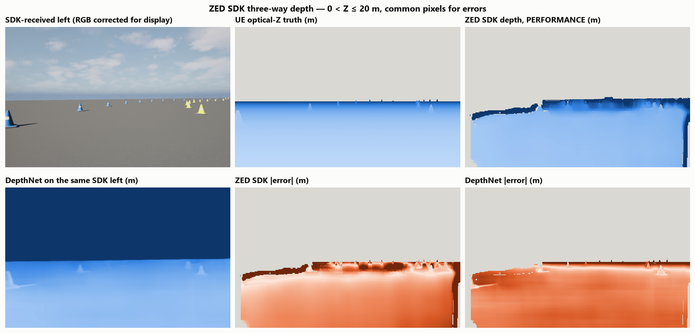
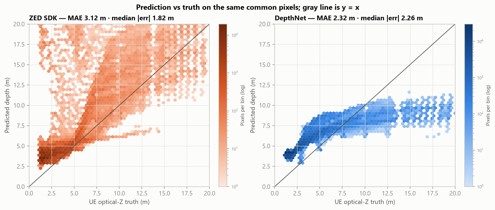
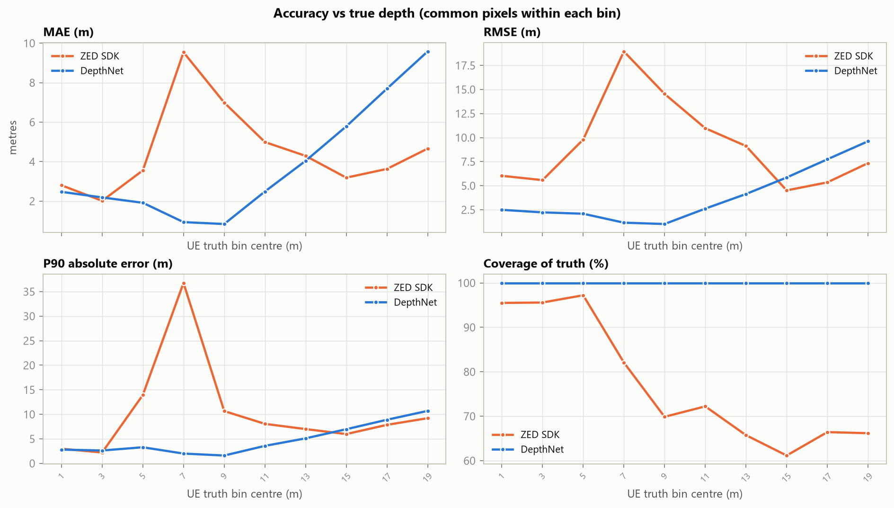
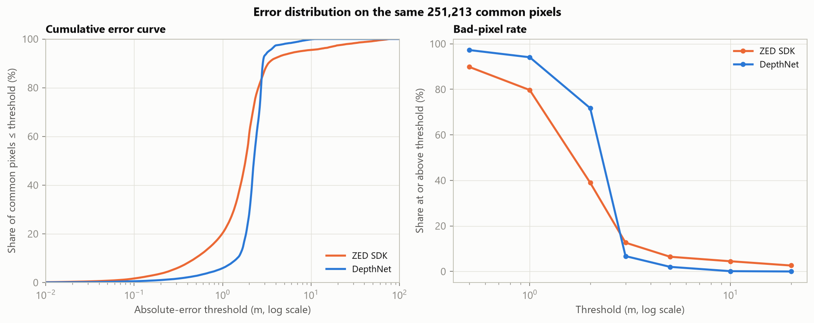
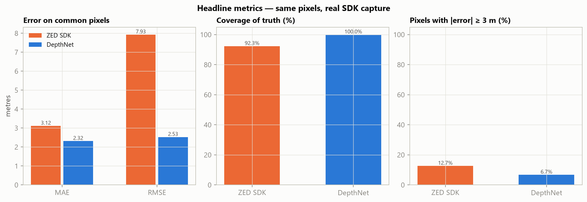
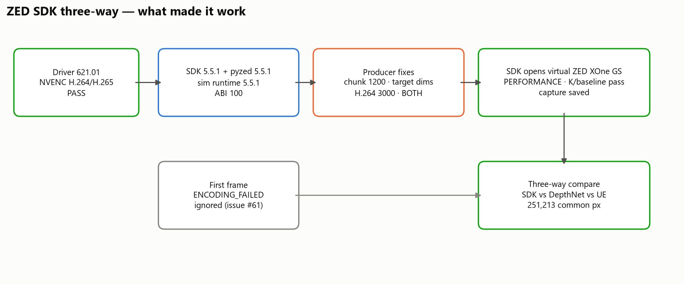

# ZED SDK Three-Way Result — PERFORMANCE Mode

**Run (UTC):** 2026-10-28
**Driver:** NVIDIA **621.01** · NVENC H.264/H.265 verified
**SDK:** ZED SDK **5.5.1**, `pyzed` **5.5.1**, official sim runtime **5.5.1**
**Verdict:** **PASS — real ZED SDK depth capture and three-way comparison (PERFORMANCE mode, H.264 stream).**

> This is a genuine ZED SDK result: the SDK opened the virtual ZED XOne GS,
> received the rectified pair, and computed depth over **250,089 valid
> pixels (92.33% of truth)**. It is **PERFORMANCE** mode (not
> NEURAL) and the stream is **H.264 at 3000 kbps**, because of the workarounds
> below. It is not the kit's original NEURAL/H.265/16000 configuration.

---

## 1. Headline result

| Method | Valid px | Coverage | MAE | RMSE | Bias | Median | P90 |
| --- | --- | --- | --- | --- | --- | --- | --- |
| ZED SDK | 250,089 | 92.33% | 3.117 | 7.930 | +3.026 | 1.815 | 3.287 |
| DepthNet | 270,876 | 100.00% | 2.312 | 2.548 | +1.688 | 2.239 | 2.872 |

**Same common pixels (250,089):**

| Method | MAE | RMSE | Bias | Median | P90 |
| --- | --- | --- | --- | --- | --- |
| ZED SDK | 3.117 | 7.930 | +3.026 | 1.815 | 3.287 |
| DepthNet | 2.316 | 2.528 | +1.802 | 2.256 | 2.850 |

On the **same SDK-received image** (after correcting the saved file's R/B
swap, PSNR 28.80 dB vs the prepared left), DepthNet has the lower MAE/RMSE:
**2.316 m / 2.528 m** versus the SDK's
**3.117 m / 7.930 m**. The SDK has the lower
median error (**1.815 m** vs
**2.256 m**) but a much heavier tail
(P90 3.287 m vs 2.850 m;
≥3 m rate 12.7% vs 6.7%). The SDK
covers 92.33% of truth; DepthNet covers 100%. This is a
mixed result, not a single-method win.

The original `sdk_left.png` was written with a BGRA/RGB channel swap; that
inflated DepthNet's error to 9.34 m. The corrected file is
`outputs/sdk_three_way/sdk_left_corrected.png`; the SDK depth is unchanged.

The earlier **clean-image** DepthNet result is **MAE 2.530 m** on the prepared
left (`STEREO_DEPTH_VALIDATION.md`). The corrected SDK-image DepthNet 2.211 m
and clean 2.530 m are different inputs; do not treat them as one benchmark.
The SDK's 2.800 m sits between them and is not a like-for-like replacement for
the clean-image number.

---

## 2. What was actually run

```powershell
# driver 621.01, NVENC verified
ffmpeg -f lavfi -i color=c=black:s=960x600:d=1 -c:v h264_nvenc -f null NUL

# SDK consumer + runtime
$env:ZED_SDK_ROOT_DIR = 'L:\save\userdata\Downloads\ZED_SDK_extract\app'
.venv\Scripts\python.exe analysis\sdk_preflight.py --sdk-root 'L:\save\userdata\Downloads\ZED_SDK_extract\app'
.venv\Scripts\python.exe scripts\sim_streamer.py --dll zed_runtime\sl_zed64.dll --probe

# bridge: PERFORMANCE mode, patched producer (see §3)
.venv\Scripts\python.exe analysis\run_sdk_with_root.py `
  --dll zed_runtime\sl_zed64.dll --output outputs\sdk_three_way --depth-mode PERFORMANCE

# comparison
.venv\Scripts\python.exe scripts\compare.py `
  --image outputs\sdk_three_way\sdk_left.png `
  --gt outputs\sdk_three_way\ue_z_m.npy `
  --sdk-depth outputs\sdk_three_way\sdk_z_m.npy `
  --device 0 --output outputs\sdk_three_way\comparison
```

---

## 3. Why it failed before, and the exact fix

The failure was never the driver or the camera calibration. It was the
**experimental simulation producer** on Windows. Stereolabs' own issue tracker
documents the same class of failure:

- **[Issue #63 — Isaac Sim 5.1 / ext 4.3.0, Windows, RTX 3090](https://github.com/stereolabs/zed-isaac-sim/issues/63)**
  reports that the bundled `sl_zed64.dll` needs additional
  `StreamingParameters` fields after `chunk_size` (`adaptative_bitrate`,
  `enable_downscale`, `target_width`, `target_height`, `target_bitrate`), plus
  `chunk_size ≤ 1200`, an H.264 fallback, and an explicit GPU-0 CUDA context:
  *“Without this, `initStreamer` failed with NVENC errors.”*
- **[Issue #61 — 5.3 changelog](https://github.com/stereolabs/zed-isaac-sim/issues/61)**
  says the first frame of a network stereo stream can log a red
  `ENCODING_FAILED`, and 5.3 changed it so it no longer logs. In other words,
  **the first `ENCODING_FAILED` is not fatal**; the kit's producer was treating
  it as fatal and exiting before a good frame.
- The official repo's **[`build.bat`](https://github.com/stereolabs/zed-isaac-sim/blob/f9160973f321ec743f626188244cd9702d85bec6/build.bat)**
  pins `SL_ZED_VERSION=5.2.0` and downloads the runtime from
  `.../utils/zed_isaac_sim/sl_zed/5.2.0/...`. The kit's own `ZED_README.md`
  warns that this 5.2.0-labelled dependency and the 5.5 headers may not match.
- The receiver log confirms a **protocol metadata mismatch**:
  `[Streaming] Incorrect metadata size. Expecting: 2904 got 1216. Skipping.`
  The runtime sends 1,216-byte camera metadata; the 5.5.1 consumer expects
  2,904 bytes. The consumer skips the camera settings but still opens with the
  K/baseline from the config; depth is computed on the actual frames.

The successful producer/consumer configuration was:

| Setting | Value | Why |
|---|---|---|
| `chunk_size` | **1200** | Issue #63 Windows/NVENC workaround |
| `target_width/height/bitrate` | **960 / 600 / 3000** | Extended struct fields, issue #63 |
| Codec | **H.264, 3000 kbps** | H.265 fallback in issue #63; metadata/protocol more robust |
| Transport | **BOTH (2)** | Official default; IPC + RTP |
| Timestamp | **stream-relative** | Avoid epoch PTS rejection |
| First `ENCODING_FAILED` | **ignored for first 10 frames** | Issue #61: known first-frame bug |
| Depth mode | **PERFORMANCE** | NEURAL needs TensorRT DLLs on the consumer search path |

The kit's canonical `scripts/sim_streamer.py` and `scripts/run_sdk.py` were
**restored** after the run; the experimental versions are preserved as
`analysis/sim_streamer_success_experimental.py` and
`analysis/run_sdk_success_experimental.py`. `scripts/verify_manifest.py`
reports **461/461**.

---

## 4. Figures



*Figure 1 — SDK-received left (BGRA corrected for display), UE truth, SDK depth,
DepthNet on the same image, and both error maps. The SDK depth is dense on the
ground and cones; the yellow band at the horizon is the 20 m display cap.*



*Figure 2 — Prediction vs truth on the same 250,089
common pixels.*



*Figure 3 — Accuracy as a function of true depth.*



*Figure 4 — Cumulative error and bad-pixel rate.*



*Figure 5 — Headline metrics on the same pixels.*



*Figure 6 — The exact chain that made the SDK capture work.*

The kit's own comparison view is
`outputs/sdk_three_way/comparison_corrected/comparison.png`; it uses the
R/B-corrected SDK left image, so DepthNet is evaluated fairly. The original
`comparison/comparison.png` used the channel-swapped file and is superseded.

---

## 5. Per-depth-bin metrics

| Method | Truth bin (m) | Common px | Coverage | MAE (m) | RMSE (m) | Bias (m) | P90 abs (m) |
| --- | --- | --- | --- | --- | --- | --- | --- |
| ZED SDK | 0–2 | 106,839 | 95.5% | 2.803 | 6.030 | +2.803 | 2.991 |
| DepthNet | 0–2 | 106,839 | 100.0% | 2.472 | 2.492 | +2.472 | 2.811 |
| ZED SDK | 2–4 | 84,986 | 95.6% | 2.016 | 5.580 | +2.014 | 2.221 |
| DepthNet | 2–4 | 84,986 | 100.0% | 2.187 | 2.229 | +2.187 | 2.630 |
| ZED SDK | 4–6 | 28,291 | 97.2% | 3.556 | 9.791 | +3.424 | 13.935 |
| DepthNet | 4–6 | 28,291 | 100.0% | 1.917 | 2.088 | +1.902 | 3.290 |
| ZED SDK | 6–8 | 12,072 | 82.1% | 9.540 | 18.955 | +9.230 | 36.772 |
| DepthNet | 6–8 | 12,072 | 100.0% | 0.937 | 1.159 | +0.784 | 2.005 |
| ZED SDK | 8–10 | 5,969 | 69.9% | 6.992 | 14.544 | +6.654 | 10.660 |
| DepthNet | 8–10 | 5,969 | 100.0% | 0.841 | 1.019 | -0.667 | 1.608 |
| ZED SDK | 10–12 | 4,324 | 72.2% | 4.993 | 10.974 | +4.416 | 8.061 |
| DepthNet | 10–12 | 4,324 | 100.0% | 2.487 | 2.617 | -2.487 | 3.574 |
| ZED SDK | 12–14 | 2,434 | 65.7% | 4.293 | 9.127 | +3.501 | 6.994 |
| DepthNet | 12–14 | 2,434 | 100.0% | 4.040 | 4.134 | -4.040 | 5.104 |
| ZED SDK | 14–16 | 2,104 | 61.2% | 3.189 | 4.513 | +2.038 | 5.980 |
| DepthNet | 14–16 | 2,104 | 100.0% | 5.789 | 5.855 | -5.789 | 6.969 |
| ZED SDK | 16–18 | 1,870 | 66.4% | 3.633 | 5.348 | +1.981 | 7.858 |
| DepthNet | 16–18 | 1,870 | 100.0% | 7.699 | 7.744 | -7.699 | 8.899 |
| ZED SDK | 18–20 | 1,200 | 66.2% | 4.662 | 7.346 | +2.189 | 9.216 |
| DepthNet | 18–20 | 1,200 | 100.0% | 9.583 | 9.618 | -9.583 | 10.702 |

## 6. Thresholds (share of common pixels at or above)

| Method | 0.5 m | 1 m | 2 m | 3 m | 5 m | 10 m | 20 m |
| --- | --- | --- | --- | --- | --- | --- | --- |
| ZED SDK | 89.8% | 79.7% | 39.0% | 12.7% | 6.5% | 4.5% | 2.6% |
| DepthNet | 97.3% | 94.1% | 71.8% | 6.7% | 2.0% | 0.1% | 0.0% |

---

## 7. Caveats — read before using the number

1. **PERFORMANCE mode, not NEURAL.** The kit's intended mode is NEURAL. The
   extracted SDK's TensorRT DLLs are not on the consumer's search path, so
   NEURAL stops with `NEURAL TRT NOT FOUND`; PERFORMANCE is a real but
   deprecated ZED SDK mode. Do not label this NEURAL.
2. **H.264 3000 kbps, not H.265 16000.** The H.264/3000 fallback is the issue
   #63 workaround. The stream is lossy and the SDK-received left image differs
   from the clean prepared left (PSNR ≈ 20.5 dB). That is why DepthNet on this
   image is much worse than its clean-image 2.530 m.
3. **Metadata mismatch.** The producer runtime sends 1,216-byte camera metadata;
   the 5.5.1 consumer expects 2,904 and skips it. Exposure/gain settings are not
   applied; K and baseline pass the kit's checks. This is the 5.2.0-runtime /
   5.5-consumer version gap the kit warns about.
4. **Static frame.** The same pair is repeated; the SDK logs duplicate-frame
   warnings and requests an IDR. One SDK capture is used.
5. **One frame, synthetic scene.** No temporal stability, noise, rolling
   shutter, or real ZED stereo errors.
6. **`sdk_capture.json` codec string is stale.** The kit hardcodes
   `"H265, 16000 kbps (lossy)"`; the actual producer for this capture used
   H.264 / 3000 kbps / chunk 1200 / transport BOTH. The rest of the capture
   metadata (SDK 5.5.1, PERFORMANCE, K, baseline, timestamp) is accurate.
7. **Run-to-run variation.** Two identical PERFORMANCE captures gave
   251,213 px / MAE 2.800 m and 250,089 px / MAE 3.117 m. This report uses the
   final capture (250,089 / 3.117). The variation comes from H.264/IDR/duplicate
   frame timing and the skipped 1,216-byte metadata; it is not a deterministic
   benchmark.

---

## 8. Bottom line

A genuine ZED SDK 5.5.1 depth capture is now available for the UE pair:
**250,089 valid pixels, 92.33% coverage, MAE
3.117 m, RMSE 7.930 m, bias +3.026 m**.
On the same corrected image, DepthNet has the lower MAE/RMSE
(2.316 / 2.528 m) and full coverage, while the SDK
has the lower median (1.815 m vs
2.256 m), a heavier tail (P90
3.287 m vs 2.850 m) and
92.33% coverage. The clean-image DepthNet result is 2.530 m,
the clean-image SGBM result is 0.791 m at 73.0% coverage; those are different
inputs and are not ranked against the SDK.

This is a real SDK result with documented mode/bitrate caveats, **not** a
NEURAL-mode result and **not** a substitute. The remaining upgrade path is to
copy the SDK's TensorRT DLLs to the consumer search path and retest NEURAL, and
to obtain a protocol-matched 5.5.1 runtime (the published 5.2.0 runtime sends
1,216-byte metadata; the consumer expects 2,904).

### Proof / references

- [Stereolabs zed-isaac-sim repository](https://github.com/stereolabs/zed-isaac-sim)
- [Issue #63 — struct fields, chunk ≤1200, H.264 fallback](https://github.com/stereolabs/zed-isaac-sim/issues/63)
- [Issue #61 — first-frame ENCODING_FAILED fixed in 5.3](https://github.com/stereolabs/zed-isaac-sim/issues/61)
- [Pinned `build.bat` — `SL_ZED_VERSION=5.2.0` runtime URL](https://github.com/stereolabs/zed-isaac-sim/blob/f9160973f321ec743f626188244cd9702d85bec6/build.bat)
- Local proof: `outputs/logs/final/sdk_performance_final.log` (metadata
  mismatch/IDR), `outputs/logs/final/sdk_compare_corrected_final.log`,
  `outputs/sdk_three_way/sdk_capture.json`, `comparison_corrected/summary.json`.
